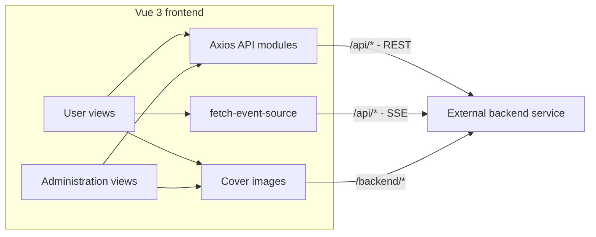

# Mental Health AI Assistant

A Vue 3 web application that brings AI conversations, daily mood journaling, and mental health resources into one place. It includes a user interface for everyday reflection and an administration interface for managing content and reviewing activity.

This repository contains the **frontend application**. Authentication, data persistence, AI responses, and analytics are provided by a separate backend service.

## Contents

- [Project Background](#project-background)
- [Technology Stack](#technology-stack)
- [Implemented Features](#implemented-features)
- [Architecture and Implementation](#architecture-and-implementation)
- [Project Structure](#project-structure)
- [Getting Started](#getting-started)
- [Backend Integration](#backend-integration)
- [Available Scripts](#available-scripts)
- [Deployment](#deployment)
- [Current Scope and Future Improvements](#current-scope-and-future-improvements)

## Project Background

Everyday stress, anxiety, and loneliness can be difficult to put into words. This project explores how a web application can make it easier to start a conversation, record feelings, and find relevant educational content.

The experience is organized around three activities:

1. **Talk:** share thoughts with an AI assistant through a conversational interface.
2. **Reflect:** record mood, emotional triggers, sleep quality, and stress in a structured diary.
3. **Learn:** browse published mental health articles and discover recommended reading.

The administration interface supports the other side of that experience: publishing educational content, inspecting consultation and diary records, and viewing usage trends. Together, these workflows demonstrate frontend development across forms, streaming responses, content management, authentication, and data visualization.

## Technology Stack

Versions below describe the dependency ranges declared in `package.json`; `package-lock.json` records the resolved installation.

| Area | Technology | Role in the project |
| --- | --- | --- |
| UI framework | Vue 3.5 | Single File Components, Composition API, and reactive UI state |
| Build tooling | Vite 8 with `@vitejs/plugin-vue` | Development server, module processing, and production builds |
| Language | JavaScript with ES modules | Application logic and API integration |
| Routing | Vue Router 4.6 | Nested layouts, lazy-loaded views, and navigation guards |
| Shared state | Pinia 3 | Administration sidebar collapse state |
| UI components | Element Plus 2.13 and Element Plus Icons | Forms, tables, dialogs, navigation, feedback, and icons |
| HTTP requests | Axios 1.x | Shared API client, token injection, and response handling |
| AI response streaming | `@microsoft/fetch-event-source` 2 | Server-Sent Events over a POST request |
| Charts | Apache ECharts 5.6 | Mood, consultation, and user activity visualizations |
| Rich text editing | wangEditor 5 with its Vue integration | Article authoring, formatting, and content preview |
| Styling | CSS and Sass/SCSS | Global styles and scoped component styles |
| Hosting configuration | Vercel rewrites | API forwarding, uploaded file access, and SPA route fallback |

## Implemented Features

### User Interface

**Home and navigation**

- Landing page with entry points to AI consultation and mood journaling.
- Shared navigation and footer across user pages.
- Navigation links that adapt to the presence of a login token.

**Registration and login**

- Registration form with username, email, nickname, phone number, password, and password confirmation fields.
- Form rules for required account fields, email format, password length, and matching passwords.
- Login with backend-issued tokens and user information stored in browser `localStorage`.
- Role-dependent redirects for regular users and administrators, plus logout integration.

**AI consultation**

- Create conversation sessions through the backend and send messages to the assistant.
- Display AI replies incrementally through Server-Sent Events (SSE).
- Show a typing indicator and disable message input while a reply is being generated.
- Support Enter to send, Shift + Enter for a new line, and a 500-character input limit.
- Load conversation history, reopen stored messages, and delete sessions.
- Display session titles, message previews, timestamps, message counts, and duration when supplied by the backend.
- Render basic Markdown in AI replies, including lists, emphasis, links, quotations, and code blocks.
- Surface HTTP errors, unexpected stream formats, backend rejection messages, and connections that close without a reply.

**Mood journal**

- Select a mood score on a 10-point scale.
- Choose from eight emotions: happy, calm, anxious, sad, excited, tired, surprised, and confused.
- Record a diary date, emotional triggers, and a written reflection of up to 2,000 characters.
- Add sleep quality and stress level on 5-point scales.
- Require a mood score, main emotion, and reflection before submission.
- Submit entries to the backend and reset the form after a successful request.

**Knowledge resources**

- Browse published article cards with cover images, summaries, categories, author information, dates, and read counts.
- Load recommended reading ordered by read count.
- Jump from a recommendation to its matching article card when that article is present in the loaded list.
- Display loading and empty states, with layouts that adapt to smaller screens.

### Administration Interface

**Analytics dashboard**

- Overview cards for total and active users, diary entries, consultation sessions, and average mood score.
- Daily additions for diary entries and consultation sessions.
- ECharts visualizations for mood trends, consultation activity, and user activity.
- Consultation statistics such as total sessions and average session duration.

**Knowledge article management**

- Search and paginate articles by title, category, and publication status.
- Create and edit articles with a category, summary, tags, cover image, and rich text content.
- Upload article cover images with file type and size checks.
- Preview formatted content before saving.
- Publish articles, take them offline, or delete them through confirmation dialogs.

**Consultation records**

- Browse a paginated list of consultation sessions.
- Inspect session metadata and the stored user/AI message history in a detail dialog.

**Journal management**

- Search entries by user ID and mood score range.
- Inspect diary content, emotional triggers, sleep quality, stress level, and timestamps.
- Delete entries through a confirmation dialog.
- Display emotion analysis, intensity, risk fields, and suggestions **when those results are returned by the backend**. The frontend does not perform this analysis itself.

**Shared administration layout**

- Collapsible sidebar with route-based menu entries and page titles.
- Reusable page headers, search forms, tables, dialogs, and pagination controls.

## Architecture and Implementation

### Application Layers



`FrontendLayout`, `BackendLayout`, and `AuthLayout` provide separate shells for the main user experience, administration pages, and account forms. API functions live in `src/api/`, while `src/utils/requires.js` configures the shared Axios client.

### Streaming Conversation Flow

1. The user submits a message. For a new conversation, the frontend first calls the session creation endpoint.
2. The frontend sends the session identifier and message to `/api/psychological-chat/stream` using a POST request with `Accept: text/event-stream`.
3. Incoming text chunks are appended to a reactive AI message, updating the conversation as data arrives.
4. The handler accepts plain text chunks and several JSON text payload shapes, and ignores metadata-only events.
5. A `done` event or `[DONE]` marker ends the response. Errors are shown in the conversation and through Element Plus feedback.

The AI model, prompting, and response generation are backend responsibilities; no model runs in this frontend repository.

### Authentication and Roles

The login response supplies a `token` and `userInfo`. The client stores both locally, attaches the token through a custom `token` request header, and uses `userInfo.userType` for navigation:

| Role value | Client behavior |
| --- | --- |
| `1` | Regular user; redirected away from administration and authentication pages after login |
| `2` | Administrator; directed to the administration area |

Unauthenticated navigation to `/back/*` redirects to `/auth/login`. These guards control browser navigation; the backend must also enforce permissions on its endpoints.

## Project Structure

```text
AI-Vue/
|-- public/                 # Static icons and favicon
|-- src/
|   |-- api/
|   |   |-- admin.js        # Authentication, articles, records, analytics
|   |   `-- frontend.js     # Registration, sessions, diary, resources
|   |-- assets/images/      # Assistant, mood, and dashboard images
|   |-- components/         # Layouts, editor, dialogs, Markdown, shared UI
|   |-- config/index.js     # Backend file resource URL prefix
|   |-- router/index.js     # Routes and navigation guards
|   |-- stores/admin.js     # Sidebar state
|   |-- utils/
|   |   |-- chart.js        # Chart tooltip formatting
|   |   `-- requires.js     # Axios client and interceptors
|   |-- views/              # User, authentication, and administration pages
|   |-- App.vue             # Root router outlet
|   |-- main.js             # Application and plugin registration
|   `-- style.css           # Global styling
|-- index.html
|-- package.json
|-- package-lock.json
|-- vercel.json             # Production rewrites
`-- vite.config.js          # Vue plugin, @ alias, development API proxy
```

## Getting Started

### Prerequisites

- Node.js **22.12 or later**, or **20.19 or later within the Node 20 release line**, as required by the installed Vite version.
- npm.
- A compatible backend service for login, saved data, AI conversations, and administration features. Backend source code and database setup are outside this repository.

### Install and Run

```bash
git clone https://github.com/yingqilin-32/Mental-Health-AI-Assistant.git
cd Mental-Health-AI-Assistant
npm ci
```

Configure the backend destination as described below, then start the development server:

```bash
npm run dev
```

Open the local URL printed by Vite, usually `http://localhost:5173`. The UI can start independently, but features that fetch or save data require the backend to be reachable.

Register a regular user at `/auth/register`, then sign in at `/auth/login`. Administration access requires a backend account with `userType: 2`; the registration form creates regular users.

### Main Routes

| Route | Page |
| --- | --- |
| `/` | Home |
| `/auth/login` | Login |
| `/auth/register` | Registration |
| `/consultation` | AI consultation |
| `/emotion-diary` | Mood journal form |
| `/knowledge` | Published knowledge resources |
| `/back/dashboard` | Administration analytics |
| `/back/knowledge` | Article management |
| `/back/consultation` | Consultation records |
| `/back/journal` | Diary management |

## Backend Integration

### Development Proxy and File URLs

The Axios base URL is `/api`, and the streaming client also uses `/api`. During development, Vite forwards matching requests to the target in `vite.config.js`. Replace that target with your own backend origin.

For example, if your backend serves API endpoints under `/api` at `http://localhost:8080`, the following proxy configuration preserves that prefix. The additional `/backend` rule forwards cover image requests to file paths on the same backend:

```js
// server configuration inside vite.config.js
server: {
  proxy: {
    '/api': {
      target: 'http://localhost:8080',
      changeOrigin: true,
    },
    '/backend': {
      target: 'http://localhost:8080',
      changeOrigin: true,
      rewrite: (path) => path.replace(/^\/backend/, ''),
    },
  },
},
```

The checked-in development configuration currently proxies `/api` only. Add the `/backend` rule if uploaded images use relative paths, or configure an appropriate file origin through `fileBaseURL` in `src/config/index.js`. Its current value is `/backend`.

Backend destinations are currently configured directly in `vite.config.js` and `vercel.json`; the application does not yet read an environment variable for the API origin.

### API Expectations

The shared Axios client expects application responses shaped like:

```json
{
  "code": "200",
  "message": "Success",
  "data": {}
}
```

Both numeric `200` and string `"200"` are accepted as success codes. An application code of `"-1"` is treated as an expired login. List screens generally consume `data.records` and `data.total`; some public article requests also accept an array response.

The following paths are relative to `/api`:

| Area | Method and endpoint | Purpose |
| --- | --- | --- |
| Accounts | `POST /user/add` | Register a regular user |
| Accounts | `POST /user/login`, `POST /user/logout` | Sign in and sign out |
| Conversations | `POST /psychological-chat/session/start` | Create a session |
| Conversations | `GET /psychological-chat/sessions` | List sessions |
| Conversations | `GET /psychological-chat/sessions/:id/messages` | Load stored messages |
| Conversations | `DELETE /psychological-chat/sessions/:id` | Delete a session |
| AI streaming | `POST /psychological-chat/stream` | Stream an AI reply as SSE |
| Diary | `POST /emotion-diary` | Save a mood journal entry |
| Diary administration | `GET /emotion-diary/admin/page`, `DELETE /emotion-diary/admin/:id` | List and delete entries |
| Categories | `GET /knowledge/category/tree` | Load article categories |
| Articles | `GET /knowledge/article/page`, `GET /knowledge/article/:id` | List articles and retrieve details |
| Article management | `POST /knowledge/article`, `PUT /knowledge/article/:id`, `DELETE /knowledge/article/:id` | Create, edit, and delete articles |
| Publication | `PUT /knowledge/article/:id/status` | Set draft, published, or offline status |
| Uploads | `POST /file/upload` | Upload an article cover as multipart form data |
| Analytics | `GET /data-analytics/overview` | Load dashboard metrics and chart data |

This table documents the frontend's integration points. A working backend must implement compatible request fields, response data, authentication, and streaming behavior.

## Available Scripts

| Command | Description |
| --- | --- |
| `npm ci` | Install dependencies from the committed lockfile |
| `npm run dev` | Start the Vite development server |
| `npm run build` | Generate the production bundle in `dist/` |
| `npm run preview` | Serve the production bundle locally for inspection |

There are currently no dedicated lint or automated test scripts in `package.json`.

## Deployment

The repository includes `vercel.json` with three routing rules:

1. Forward `/api/*` to the backend's `/api/*` endpoints.
2. Forward `/backend/*` to backend file resources, removing the `/backend` prefix.
3. Serve `index.html` for other paths so Vue Router history navigation works on direct visits and refreshes.

To deploy on Vercel, import the repository, use the Vite framework preset, set the build command to `npm run build`, and use `dist` as the output directory. Update the backend destinations in `vercel.json` for your environment before deploying.

On other hosts, serve `dist/`, configure an equivalent SPA fallback, and forward the API and file paths. The AI stream requires the proxy to pass through `text/event-stream` responses without buffering the entire reply.

`npm run preview` serves the built frontend and does not apply Vercel's rewrite rules. Vite's preview proxy defaults to the development server proxy configuration, so add the file proxy described above if your local preview needs `/backend/*` resources.

## Current Scope and Future Improvements

The current codebase implements the frontend screens and backend integration described above. The public knowledge page displays article cards and summaries; a dedicated full-article reading page is a possible extension. The user mood journal currently focuses on creating entries, while record browsing and review are available in the administration area.

Possible next steps include:

- A personal diary history page with individual mood trends.
- A full article reading experience with search and category browsing.
- Environment-based backend configuration shared across development and deployment.
- Broader mobile layout and accessibility improvements.
- Automated coverage for authentication, stream handling, and article workflows.

The project focuses on supportive conversation, self-reflection, and educational content. It does not provide clinical diagnosis or treatment.
